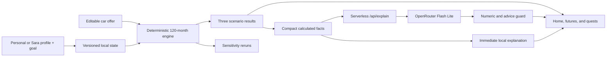

# Architecture

## Boundaries

### Deterministic domain

- `src/domain/simulationEngine.ts` owns every financial output.
- `src/domain/financing.ts` owns installment and balloon calculations.
- `src/domain/sensitivity.ts` changes named assumptions and reruns the engine.
- `src/domain/quests.ts` owns local progress, XP, consistency, levels, and badges.
- `src/domain/questRouting.ts` keeps explicit Home/future CTA intent separate from general recommendation-based Tasks navigation.

### State

`src/state/profile.ts` and `src/state/profileStorage.ts` own profile validation and migration. `src/state/FinQuestState.tsx` keeps the app/quest state in local storage. Personal profiles do not invent age or city; Sara keeps explicit synthetic facts. Invalid payloads fail closed to onboarding. Reset clears profile, app, and car-decision state.

### Presentation

`src/screens/` renders the focused decision journey. Numeric offer fields keep temporary string drafts and commit bounded values on blur/Enter. Shared dialog utilities provide portal rendering, focus trap, Escape close, background isolation, and trigger restoration. `src/avatar/` is a local SVG future-self system with one contemporary hijabi identity, semantic moods, a small-size glyph, and reduced-motion handling.

### AI explanation

`src/services/narrativeContract.ts` defines the compact boundary. `src/services/narrative.ts` creates facts, an authoritative local response, same-origin request caching, and fallback behavior. `api/explain.ts` validates the body, reads `OPENROUTER_API_KEY` server-side, rate-limits, times out, caps output, and rejects provider text that adds numbers or advice-like language.

The AI payload contains no name, city, occupation, transaction rows, source code, or conversation history.

## Deployment

Vite builds the static client. Vercel detects `api/explain.ts` as a server function. A non-API catch-all rewrite serves `index.html` for SPA refreshes while preserving `/api/*`. Without `OPENROUTER_API_KEY`, the route safely returns unavailable and the client keeps the deterministic explanation.

The deployed server reads the sensitive key only from Vercel Preview/Production environment variables. The current production deployment is `dpl_8rksyXER7r6NAuffYsy3AdWPYKRY` at https://finquest-app-mu.vercel.app/, serving `index-Blo4SwPr.js` and `index-CnhRFTL_.css`.
